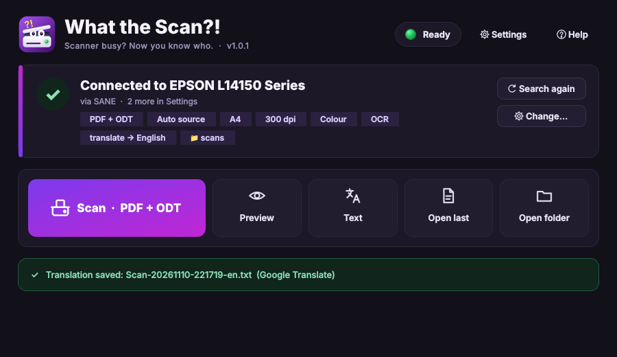
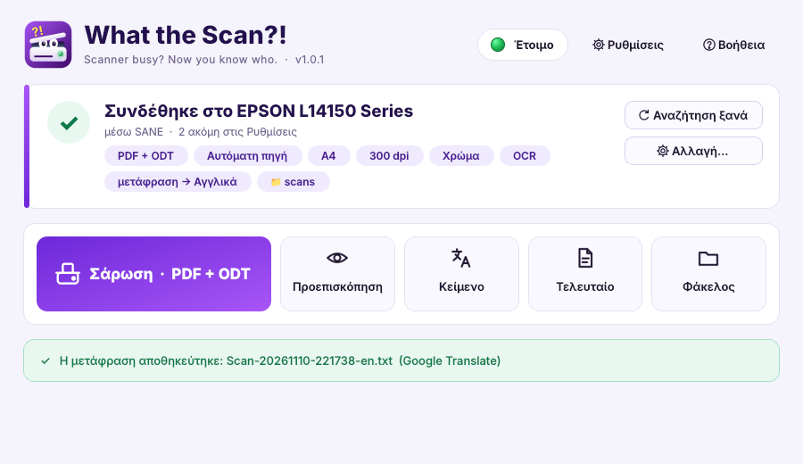

<b>Scanner busy? Now you know who.</b> 
Scan to PDF, JPG, Word or OpenDocument from Epson, Canon &amp; HP scanners, with OCR, translation
and a status light that shows when someone else on the network is using the scanner.

## Features

- **One-click scanning.** It finds every scanner on every driver (TWAIN, WIA, eSCL, SANE, Apple) at the same time and connects automatically.
- **Output formats:**
  - PDF, JPG or PDF + JPG
  - an optional editable document: Word (.docx) or OpenDocument (.odt)
- **Status light:**
  - 🟢 ready
  - 🟡 idle
  - 🔴 in use: by you, by another PC on the network running the app, or by the scanner itself (eSCL status)
  - Anyone who tries to scan while the light is red gets a clear "please wait" message and a beep when the scanner is free.
- **OCR (searchable PDFs).**
  - Languages are chosen automatically (English + Greek + your system language), or you pick them by hand.
  - Languages download automatically the first time they are used.
- **Translation** of the recognised text with Google Translate (free), MyMemory (free) or your own LibreTranslate server, either automatically after every scan or from the Text window.
- **Paper source "Auto":** uses the document feeder when it has paper, otherwise the flatbed glass.
- **English / Ελληνικά**, **Auto / Light / Dark** theme.
- **Drivers:**
  - Epson L14150 and Canon PIXMA TS3150: one-click driver install, with the publisher signature checked.
  - Other Epson, Canon and HP models (2024–2026): the Driver setup button opens the right driver page.
- **Over-the-air updates** from this repository's GitHub releases (SHA-256 checked).

## Install

Download from the [latest release](https://github.com/nikkpap/What_the_Scan-/releases/latest):

| System | File | How |
|---|---|---|
| Windows 10/11 (64-bit) | `WhatTheScan-windows-x64.exe` | Double-click it. If SmartScreen appears: *More info › Run anyway*. |
| Linux (x64) | `WhatTheScan-linux-x64` | `chmod +x WhatTheScan-linux-x64`, then open it. |
| macOS, or any OS with Python 3 | `WhatTheScan.pyw` | Double-click it. It installs PyQt6, PyMuPDF and python-docx itself. |

The first start installs the [NAPS2](https://www.naps2.com) scanning engine automatically, if it is
missing. Install your scanner's own driver if it needs one (Settings › Scanner › Driver setup).

### Offline installation

Download **`WhatTheScan-offline.zip`** from the same release and put it in the same folder as the
app. On first start the app installs everything from it, with no internet:

- NAPS2
- the Python packages
- 64-bit Python (Windows)
- the Epson L14150 and Canon TS3150 drivers
- OCR for 18 languages

Every file is still checked the same way as a download. Without the zip the app downloads what it
needs. Βάλε το zip δίπλα στην εφαρμογή και όλα εγκαθίστανται χωρίς internet.

## Εγκατάσταση (Ελληνικά)

- **Windows:** κατέβασε το `WhatTheScan-windows-x64.exe` από το [τελευταίο release](https://github.com/nikkpap/What_the_Scan-/releases/latest) και άνοιξέ το.
- **Linux:** κατέβασε το `WhatTheScan-linux-x64`, δώσε `chmod +x` και άνοιξέ το.
- **Mac ή οτιδήποτε με Python 3:** κατέβασε το `WhatTheScan.pyw` και άνοιξέ το.

Την πρώτη φορά εγκαθιστά μόνο του ό,τι χρειάζεται. Πάτα **Σάρωση** και τα αρχεία αποθηκεύονται στα
*Έγγραφα › What the Scan*. Όλες οι ρυθμίσεις είναι αυτόματες από προεπιλογή και αλλάζουν από τις **Ρυθμίσεις**.

## Publishing an update

1. Raise `VERSION` in `WhatTheScan.pyw` (for example to `1.0.2`) and update `RELEASE_NOTES.md`.
2. Commit and push to `main`.
3. If release `v1.0.2` doesn't exist yet, GitHub Actions builds the Windows .exe and the Linux
   binary and publishes the release (it creates the tag itself), with all files and their
   `.sha256` checksums.

Every copy (.exe, Linux binary or .pyw) finds its own file in the release and offers the update
from **Help › Check for updates**. It can also check by itself on startup.

## Signing the Windows .exe

GitHub signs the .exe automatically when the repository has your code-signing certificate:

1. Export your certificate as a **.pfx** with a password (for example from CertifiCat).
2. Turn it into text. In PowerShell, in the folder with the file:
   `[Convert]::ToBase64String([IO.File]::ReadAllBytes("$PWD\cert.pfx")) | Set-Clipboard`
3. On GitHub: **Settings › Secrets and variables › Actions › New repository secret**:
   - `WINDOWS_CERT_PFX`: paste the text
   - `WINDOWS_CERT_PASSWORD`: the .pfx password
4. **Actions › Build and release › Run workflow** rebuilds the current release, now signed.
   Every later release is signed automatically.

A self-signed certificate shows your name as the publisher only on PCs that trust it (install its
.cer in *Trusted Root Certification Authorities* and *Trusted Publishers*). To remove the
SmartScreen warning on every PC you need a certificate from a public certificate authority.

## Credits

Made by **Nikolaos K. Paridis** ([nikkpap](https://github.com/nikkpap)), ALU DEV TEAM.

Built with NAPS2 (GPL) and Tesseract OCR, PyMuPDF, python-docx and PyQt6.
